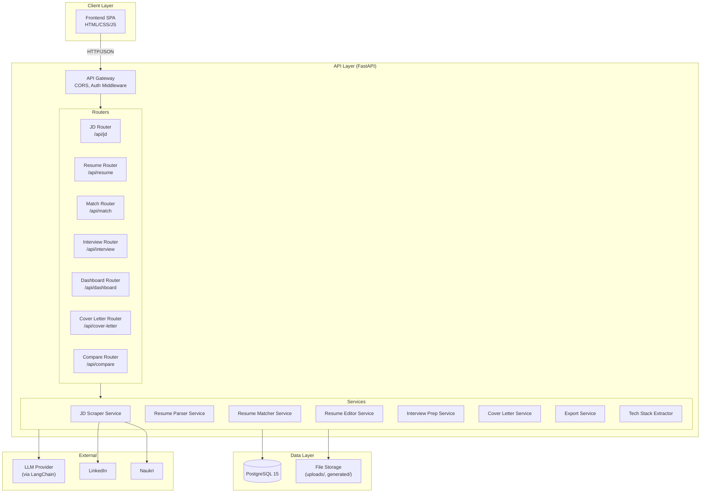
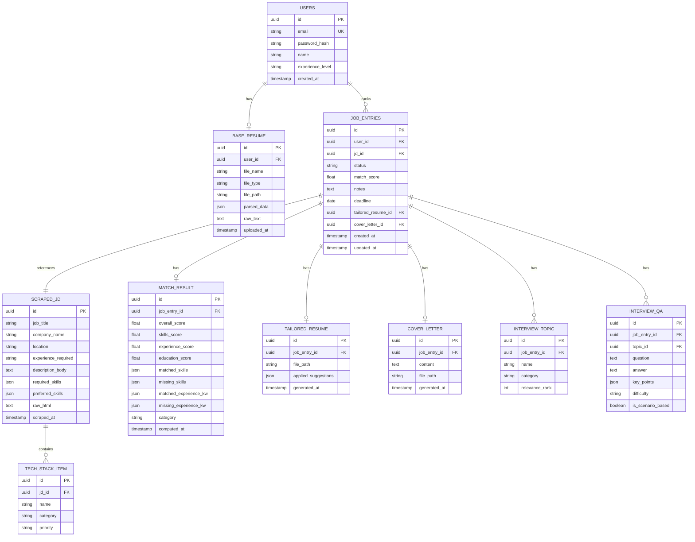

# Job Application Assistant — Technical Design

## Overview

The Job Application Assistant is a full-stack web application that automates and streamlines the job application lifecycle. It scrapes job descriptions from LinkedIn and Naukri, extracts tech stacks, matches them against a user's uploaded resume, generates tailored resumes and cover letters, provides interview preparation materials, and offers a tracking dashboard for managing applications.

The system follows a modular architecture with a Python/FastAPI backend, a PostgreSQL database for persistence, and a single-page frontend. AI/LLM capabilities power text analysis (tech stack extraction, resume matching, interview Q&A generation), while dedicated libraries handle document parsing and generation.

### Key Design Decisions

| Decision | Choice | Rationale |
|----------|--------|-----------|
| Backend Framework | FastAPI (Python 3.11+) | Async support, auto-generated OpenAPI docs, consistent with existing workspace projects |
| Database | PostgreSQL 15 | Relational data with complex queries (filtering, sorting, joins), UUID PKs |
| ORM | SQLAlchemy 2.x | Mature, well-supported, consistent with workspace patterns |
| LLM Integration | LangChain + configurable LLM provider | Abstracts provider, supports prompt templating, chaining |
| Document Parsing | pypdf + python-docx | Proven libraries for PDF/DOCX extraction |
| Document Generation | python-docx (resumes), WeasyPrint (PDF export) | Native .docx manipulation, HTML-to-PDF for interview prep |
| Web Scraping | httpx + BeautifulSoup4 | Async HTTP client + robust HTML parsing |
| Authentication | JWT (python-jose) + bcrypt (passlib) | Stateless auth, consistent with workspace pattern |
| Frontend | Vanilla HTML/CSS/JS SPA | Lightweight, no build step, consistent with workspace |

## Architecture



### Request Flow

1. Frontend sends HTTP request with JWT Bearer token
2. Auth middleware validates token, extracts user ID
3. Router delegates to appropriate service
4. Service executes business logic (scraping, LLM calls, document generation)
5. Service persists results to DB and/or filesystem
6. Response returned as JSON (or file download)

## Components and Interfaces

### 1. JD Scraper Service

**Responsibility:** Fetch and extract structured job description data from LinkedIn and Naukri URLs.

```python
class ScrapedJD(BaseModel):
    job_title: str
    company_name: str
    location: str | None
    experience_required: str | None
    description_body: str
    required_skills: list[str]
    preferred_skills: list[str]
    raw_html: str  # preserved for re-parsing

class JDScraperService:
    async def scrape(self, url: str) -> ScrapedJD:
        """Scrape and parse a job posting URL."""
        
    def _detect_platform(self, url: str) -> str:
        """Return 'linkedin', 'naukri', or raise UnsupportedURLError."""
        
    async def _scrape_linkedin(self, url: str) -> ScrapedJD: ...
    async def _scrape_naukri(self, url: str) -> ScrapedJD: ...
    
    def parse_to_structured(self, raw_text: str) -> ScrapedJD:
        """Parse raw JD text into structured fields."""
        
    def format_pretty(self, jd: ScrapedJD) -> str:
        """Format a ScrapedJD into a clean, readable string."""
```

### 2. Tech Stack Extractor

**Responsibility:** Analyze job descriptions and extract categorized technology requirements.

```python
class TechStackItem(BaseModel):
    name: str
    category: str  # "language", "framework", "database", "cloud", "tool"
    priority: str  # "required" or "nice_to_have"

class TechStackResult(BaseModel):
    items: list[TechStackItem]
    required: list[TechStackItem]
    nice_to_have: list[TechStackItem]

class TechStackExtractorService:
    async def extract(self, jd_text: str) -> TechStackResult:
        """Extract and categorize technologies from JD text using LLM."""
        
    async def identify_skill_gaps(
        self, tech_stack: TechStackResult, resume_skills: list[str]
    ) -> SkillGapResult:
        """Compare tech stack against resume skills."""
```

### 3. Resume Parser Service

**Responsibility:** Parse uploaded resumes (PDF/DOCX) into structured data.

```python
class ParsedResume(BaseModel):
    contact: ContactInfo
    skills: list[str]
    experience: list[WorkExperience]
    education: list[Education]
    certifications: list[str]
    raw_text: str

class ResumeParserService:
    def parse(self, file_path: str, file_type: str) -> ParsedResume:
        """Parse a resume file into structured sections."""
        
    def _parse_pdf(self, file_path: str) -> str: ...
    def _parse_docx(self, file_path: str) -> str: ...
    
    def _extract_sections(self, text: str) -> ParsedResume:
        """Use LLM to extract structured sections from raw text."""
```

### 4. Resume Matcher Service

**Responsibility:** Compute match scores between resumes and job descriptions.

```python
class MatchBreakdown(BaseModel):
    overall_score: float  # 0-100
    skills_score: float
    experience_score: float
    education_score: float
    matched_skills: list[str]
    missing_skills: list[str]
    matched_experience_keywords: list[str]
    missing_experience_keywords: list[str]
    category: str  # "Strong Match", "Moderate Match", "Weak Match"

class ResumeMatcherService:
    def compute_match(
        self, parsed_resume: ParsedResume, scraped_jd: ScrapedJD
    ) -> MatchBreakdown:
        """Compute weighted match score with breakdown."""
        
    def _compute_skills_score(self, resume_skills: list[str], jd_skills: list[str]) -> float: ...
    def _compute_experience_score(self, resume_exp: list[WorkExperience], jd_text: str) -> float: ...
    def _compute_education_score(self, resume_edu: list[Education], jd_text: str) -> float: ...
    def _categorize_score(self, score: float) -> str: ...
```

### 5. Resume Editor Service

**Responsibility:** Generate edit suggestions and produce tailored Word documents.

```python
class EditSuggestion(BaseModel):
    category: str  # "skills_to_add", "experience_rephrase", "keywords_to_include", "sections_reorder"
    description: str
    impact: str  # "high", "medium", "low"
    original_text: str | None
    suggested_text: str | None

class ResumeEditorService:
    async def generate_suggestions(
        self, match: MatchBreakdown, resume: ParsedResume, jd: ScrapedJD
    ) -> list[EditSuggestion]:
        """Generate prioritized edit suggestions via LLM."""
        
    def generate_tailored_docx(
        self, base_resume_path: str, suggestions: list[EditSuggestion]
    ) -> str:
        """Apply suggestions to base resume and return path to new .docx."""
        
    def _apply_edits_to_docx(self, doc: Document, suggestions: list[EditSuggestion]) -> Document: ...
    def _highlight_changes(self, doc: Document, changes: list[dict]) -> Document: ...
```

### 6. Interview Prep Service

**Responsibility:** Generate interview topics and categorized Q&A sets.

```python
class InterviewTopic(BaseModel):
    name: str
    category: str  # "technical", "domain", "behavioral"
    relevance_rank: int

class InterviewQA(BaseModel):
    question: str
    answer: str
    key_points: list[str]
    difficulty: str  # "easy", "medium", "difficult"
    is_scenario_based: bool
    topic: str

class InterviewPrepService:
    async def generate_topics(self, jd: ScrapedJD) -> list[InterviewTopic]:
        """Generate ranked interview topics from JD."""
        
    async def generate_qa(
        self, topics: list[InterviewTopic], jd: ScrapedJD, experience_level: str
    ) -> list[InterviewQA]:
        """Generate Q&A sets per topic, min 5 per difficulty per major topic."""
```

### 7. Cover Letter Service

**Responsibility:** Generate tailored cover letters.

```python
class CoverLetterService:
    async def generate(
        self, resume: ParsedResume, jd: ScrapedJD, experience_level: str
    ) -> str:
        """Generate a structured cover letter via LLM."""
        
    def export_docx(self, content: str, job_title: str, company: str) -> str:
        """Export cover letter as .docx, return file path."""
```

### 8. Export Service

**Responsibility:** Export interview prep and other content as PDF.

```python
class ExportService:
    def export_interview_prep_pdf(
        self, topics: list[InterviewTopic], qa: list[InterviewQA],
        job_title: str, company_name: str
    ) -> str:
        """Generate formatted PDF of interview prep, return file path."""
```

### API Routes

| Method | Path | Description | Auth |
|--------|------|-------------|:----:|
| POST | `/api/auth/register` | Register user | ✗ |
| POST | `/api/auth/login` | Login, get JWT | ✗ |
| GET | `/api/auth/me` | Current user profile | ✓ |
| POST | `/api/jd/scrape` | Scrape JD from URL | ✓ |
| GET | `/api/jd/{id}` | Get scraped JD details | ✓ |
| GET | `/api/jd/{id}/tech-stack` | Get extracted tech stack | ✓ |
| POST | `/api/resume/upload` | Upload base resume | ✓ |
| GET | `/api/resume` | Get current resume details | ✓ |
| POST | `/api/match/{jd_id}` | Compute match score | ✓ |
| GET | `/api/match/{jd_id}` | Get match results | ✓ |
| GET | `/api/match/{jd_id}/suggestions` | Get resume edit suggestions | ✓ |
| POST | `/api/match/{jd_id}/generate-resume` | Generate tailored resume | ✓ |
| GET | `/api/match/{jd_id}/download-resume` | Download tailored resume | ✓ |
| GET | `/api/match/{jd_id}/skill-gaps` | Get skill gap analysis | ✓ |
| POST | `/api/interview/{jd_id}/topics` | Generate interview topics | ✓ |
| POST | `/api/interview/{jd_id}/qa` | Generate Q&A sets | ✓ |
| GET | `/api/interview/{jd_id}/export-pdf` | Export interview prep as PDF | ✓ |
| POST | `/api/cover-letter/{jd_id}` | Generate cover letter | ✓ |
| GET | `/api/cover-letter/{jd_id}/download` | Download cover letter .docx | ✓ |
| GET | `/api/dashboard` | Get application dashboard | ✓ |
| PATCH | `/api/dashboard/{entry_id}` | Update status/notes/deadline | ✓ |
| DELETE | `/api/dashboard/{entry_id}` | Delete dashboard entry | ✓ |
| GET | `/api/dashboard/summary` | Get dashboard summary stats | ✓ |
| POST | `/api/compare` | Compare multiple JDs | ✓ |

## Data Models

### Entity-Relationship Diagram



### Table Definitions

#### `users`
| Column | Type | Constraints |
|--------|------|-------------|
| id | UUID | PK, default uuid4 |
| email | VARCHAR(255) | UNIQUE, NOT NULL |
| password_hash | VARCHAR(255) | NOT NULL |
| name | VARCHAR(255) | NOT NULL |
| experience_level | VARCHAR(50) | NULLABLE |
| created_at | TIMESTAMP | DEFAULT now() |

#### `base_resumes`
| Column | Type | Constraints |
|--------|------|-------------|
| id | UUID | PK, default uuid4 |
| user_id | UUID | FK → users.id, UNIQUE (one per user) |
| file_name | VARCHAR(255) | NOT NULL |
| file_type | VARCHAR(10) | NOT NULL ("pdf" or "docx") |
| file_path | VARCHAR(500) | NOT NULL |
| parsed_data | JSONB | NOT NULL |
| raw_text | TEXT | NOT NULL |
| uploaded_at | TIMESTAMP | DEFAULT now() |

#### `scraped_jds`
| Column | Type | Constraints |
|--------|------|-------------|
| id | UUID | PK, default uuid4 |
| job_title | VARCHAR(500) | NOT NULL |
| company_name | VARCHAR(255) | NOT NULL |
| location | VARCHAR(255) | NULLABLE |
| experience_required | VARCHAR(100) | NULLABLE |
| description_body | TEXT | NOT NULL |
| required_skills | JSONB | NOT NULL, default [] |
| preferred_skills | JSONB | NOT NULL, default [] |
| raw_html | TEXT | NOT NULL |
| scraped_at | TIMESTAMP | DEFAULT now() |

#### `tech_stack_items`
| Column | Type | Constraints |
|--------|------|-------------|
| id | UUID | PK, default uuid4 |
| jd_id | UUID | FK → scraped_jds.id, ON DELETE CASCADE |
| name | VARCHAR(100) | NOT NULL |
| category | VARCHAR(50) | NOT NULL |
| priority | VARCHAR(20) | NOT NULL |

#### `job_entries`
| Column | Type | Constraints |
|--------|------|-------------|
| id | UUID | PK, default uuid4 |
| user_id | UUID | FK → users.id, ON DELETE CASCADE |
| jd_id | UUID | FK → scraped_jds.id |
| status | VARCHAR(30) | NOT NULL, DEFAULT "not_applied" |
| match_score | NUMERIC(5,2) | NULLABLE |
| notes | TEXT | NULLABLE |
| deadline | DATE | NULLABLE |
| tailored_resume_id | UUID | FK → tailored_resumes.id, NULLABLE |
| cover_letter_id | UUID | FK → cover_letters.id, NULLABLE |
| created_at | TIMESTAMP | DEFAULT now() |
| updated_at | TIMESTAMP | DEFAULT now(), ON UPDATE now() |

Valid statuses: `not_applied`, `applied`, `interview_scheduled`, `interview_completed`, `offered`, `rejected`

#### `match_results`
| Column | Type | Constraints |
|--------|------|-------------|
| id | UUID | PK, default uuid4 |
| job_entry_id | UUID | FK → job_entries.id, ON DELETE CASCADE, UNIQUE |
| overall_score | NUMERIC(5,2) | NOT NULL |
| skills_score | NUMERIC(5,2) | NOT NULL |
| experience_score | NUMERIC(5,2) | NOT NULL |
| education_score | NUMERIC(5,2) | NOT NULL |
| matched_skills | JSONB | NOT NULL |
| missing_skills | JSONB | NOT NULL |
| matched_experience_kw | JSONB | NOT NULL |
| missing_experience_kw | JSONB | NOT NULL |
| category | VARCHAR(20) | NOT NULL |
| computed_at | TIMESTAMP | DEFAULT now() |

#### `tailored_resumes`
| Column | Type | Constraints |
|--------|------|-------------|
| id | UUID | PK, default uuid4 |
| job_entry_id | UUID | FK → job_entries.id, ON DELETE CASCADE, UNIQUE |
| file_path | VARCHAR(500) | NOT NULL |
| applied_suggestions | JSONB | NOT NULL |
| generated_at | TIMESTAMP | DEFAULT now() |

#### `cover_letters`
| Column | Type | Constraints |
|--------|------|-------------|
| id | UUID | PK, default uuid4 |
| job_entry_id | UUID | FK → job_entries.id, ON DELETE CASCADE, UNIQUE |
| content | TEXT | NOT NULL |
| file_path | VARCHAR(500) | NOT NULL |
| generated_at | TIMESTAMP | DEFAULT now() |

#### `interview_topics`
| Column | Type | Constraints |
|--------|------|-------------|
| id | UUID | PK, default uuid4 |
| job_entry_id | UUID | FK → job_entries.id, ON DELETE CASCADE |
| name | VARCHAR(255) | NOT NULL |
| category | VARCHAR(50) | NOT NULL |
| relevance_rank | INTEGER | NOT NULL |

#### `interview_qas`
| Column | Type | Constraints |
|--------|------|-------------|
| id | UUID | PK, default uuid4 |
| job_entry_id | UUID | FK → job_entries.id, ON DELETE CASCADE |
| topic_id | UUID | FK → interview_topics.id, ON DELETE CASCADE |
| question | TEXT | NOT NULL |
| answer | TEXT | NOT NULL |
| key_points | JSONB | NOT NULL |
| difficulty | VARCHAR(20) | NOT NULL |
| is_scenario_based | BOOLEAN | NOT NULL, DEFAULT false |

